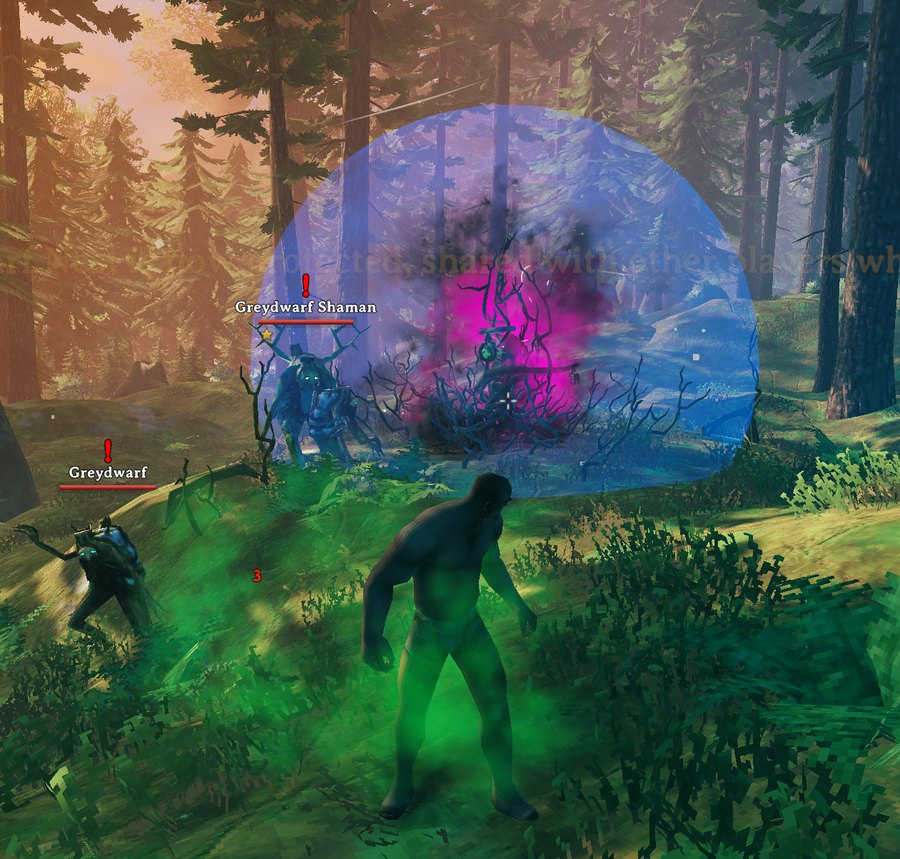
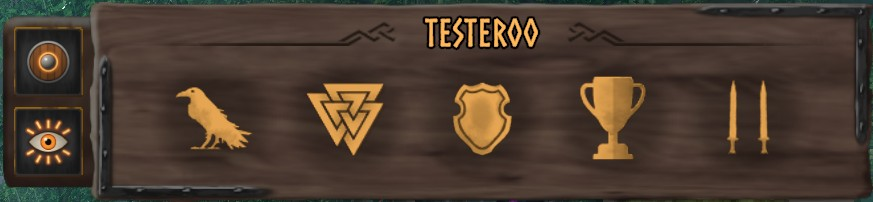
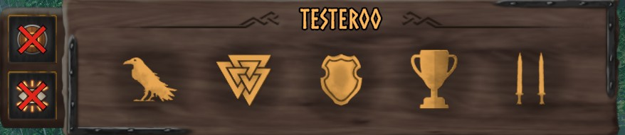
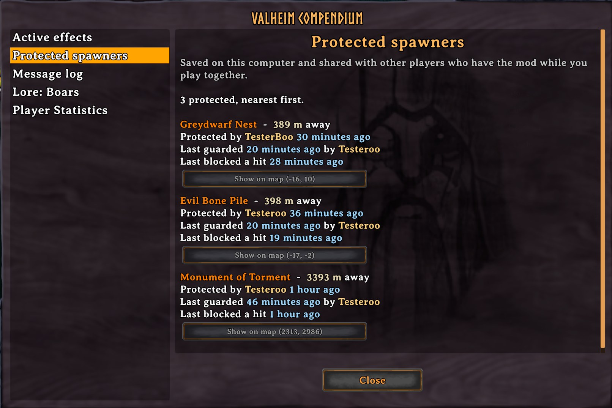
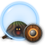
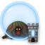
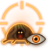

# ProtectSpawnerFarms

## Keep the spawners your farms are built around safe!

You spent hours building a farm around a Greydwarf nest or an evil bone pile, and one stray swing (yours, a friend's or a troll's) destroys it.

Open your inventory next to a spawner and click the **shield**. From then on it can't be damaged by anyone, its health is raised so players without the mod don't break it by accident, and a blue shield bubble shows everyone with the mod that it's protected.

---

### 📸 Screenshots

**Protected spawners sit inside a shield bubble.** Color and opacity are up to you.

	

**Two buttons next to your inventory** slide out when a spawner is near: protect it, and highlight it. A red cross means that thing is off.

	
	 
	

**Every protected spawner in the Compendium**, with who protected it, when it was last guarded, and a button that shows it on the map.

	

---

### 🧭 Features

- **🛡️ No damage:** every hit on a protected spawner is blocked, however far you are: yours, other players' and creatures'. Blocked hits show *Immune*. (A game with the mod has to handle the hit: the server with the mod, or a player with the mod who has that area loaded. Otherwise the raised health still keeps it from breaking by accident.)
- **🏰 Server protection:** when the server has the mod, a protected spawner can never be destroyed, by anyone, with or without the mod, and whether or not anyone with the mod is around. The server keeps its health up, and if a player's game still breaks it, the server refuses and brings it straight back at full health.
- **❤️ Raised health:** a protected spawner's health goes up to **100,000**, so even on a server without the mod, players without it can't destroy one by accident when nobody with the mod is around. Unprotecting puts its health back to normal.
- **🫧 Shield bubble:** protected spawners sit inside a shield bubble like the Staff of Protection's. You choose its color and how solid it looks.
- **🔦 Highlight:** paint the nearest spawner in a pulsing color you can see through walls, so you always know which one the buttons act on. It follows whichever spawner is nearest and turns off when you walk away.
- **🧿 Status:** near a protected spawner you get *Protecting spawner* or, when the server protects it, *Protected spawner nearby*. While highlighting, you get *Highlighting spawner*.
- **👁️ Hover info:** looking at a protected spawner shows who protected it.
- **🔐 Who can change it:** anyone, only admins, or only the player who protected a spawner (and admins) can remove its protection.
- **📖 Compendium page:** every protected spawner in the world, nearest first, with its distance, who protected it and when, when it was last guarded and last blocked a hit. **Show on map (x, z)** pins it and opens the map there, like a boss stone.
- **🤝 Saved on the spawner:** protection is stored on the spawner itself and saved with the world, so every player with the mod sees it, with or without the mod on the server.
- **🪺 Every spawner:** destructible spawners are found automatically, including new ones from game updates.

---

### 🎮 How to use it

1. Walk up to a spawner and open your inventory (**Tab**).
2. A small wooden flap slides out left of your player panel, with two buttons:
   - **Shield:** protect the closest spawner. Click again to remove protection.
   - **Eye:** highlight the nearest spawner. Click again to stop.
3. Hover a button to see which spawner it acts on and how far away it is.

The buttons show while a spawner is within **20 m**, and slide away when you walk off.

Within **20 m** of a protected spawner, a status shows which way it is kept safe. It is only for show: protection doesn't depend on it. Another status shows while the highlight is on.

| Icon | Status | When |
|:----:|--------|------|
|  | **Protecting spawner** | Your game keeps it safe by blocking hits on it (server without the mod). |
|  | **Protected spawner nearby** | The server keeps it safe by itself, whether or not anyone is near (server with the mod). |
|  | **Highlighting spawner** | The highlight is on, painting the nearest spawner. |

---

### 🪺 Spawners

| Spawner | Prefab |
| --- | --- |
| Greydwarf Nest | `Spawner_GreydwarfNest` |
| Evil Bone Pile | `BonePileSpawner`, `BonePileSpawner_swamp` |
| Body Pile | `Spawner_DraugrPile` |
| Monument of Torment | `Spawner_CharredStone`, `Spawner_CharredStone_Elite`, `Spawner_CharredStone_event` |
| Effigy of Malice | `Spawner_CharredCross` |
| Wardrobe Shaft (Deep North) | `Spawner_Hole`, `Spawner_Hole_double` |
| Malicious Ice (Deep North) | `BlackIce_Core` |
| Hexahedric Pulp | `BlobMorkBig` |
| Evil hearts | `EvilHeart_Forest`, `EvilHeart_Swamp` |

Any other destructible object that spawns creatures, including modded ones, works too.

---

## ⚙️ Installation

Install with a mod manager (r2modman, Thunderstore App), or manually:

1. Install **BepInExPack Valheim**.
2. Extract ProtectSpawnerFarms into `BepInEx/plugins`.
3. Launch the game. Settings are in `BepInEx/config/JoksterCube.ProtectSpawnerFarms.cfg`, or in game with Configuration Manager (F1).

Installing on the server is **optional**. It protects those spawners itself, lists every protected spawner in the world in everyone's Compendium, and syncs the protection settings.

---

### 🧩 Multiplayer & Compatibility

- ✅ Works in single-player, on servers **with** the mod and on servers **without** it.
- ✅ Players **without** the mod can join. They don't see the bubble, but the raised health keeps them from destroying a protected spawner by accident.
- 🤝 **Server without the mod:** protection is still saved on the spawners, so every player with the mod sees it when they get near. The Compendium lists the protected spawners you have been near on that server, and remembers them between sessions.
- 🖥️ **Server with the mod:** the server finds every protected spawner in the world, lists them all in everyone's Compendium and makes sure they can't be destroyed. **Who Can Change Protection** decides who may protect and unprotect.
- ⚠️ When both the server and a player have the mod, they need the **same version**.

Protection is saved on the spawners themselves, in the world save. Adding or removing the mod on the server keeps it. On servers without the mod, the Compendium's list is also remembered in `BepInEx/config/JoksterCube.ProtectSpawnerFarms/CompendiumCache/`, one small file per server world.

---

### 🔧 Configuration

**Synced** settings come from the server when it runs the mod, and can't be changed in game.

| Setting | Default | Synced | What it does |
| --- | --- | :---: | --- |
| Boosted Health | 100,000 | ✔ | Health of a protected spawner. `0` keeps normal health. |
| Protection Range | 20 m | ✔ | How close you need to be to a protected spawner to get the status (5–100 m). Protection itself works at any distance. |
| Who Can Change Protection | Anyone | ✔ | `Anyone`, `AdminsOnly`, or `ProtectorOrAdmin` (anyone can protect, only the protector or an admin can unprotect). |
| Action Distance | 20 m | | The buttons show when a spawner is this close (1–50 m). |
| Show Shield Bubble | On | | The bubble around protected spawners. |
| Shield Bubble Color | Blue | | Color of the bubble. |
| Shield Bubble Opacity | 0.1 | | How solid the bubble looks, from 0.01 to 1. |
| Highlight Color | Amber | | Color a highlighted spawner is painted in. |
| Show Protecting Status | On | | The Protecting spawner / Protected spawner nearby status. |
| Show Messages | On | | A message when you protect, unprotect or highlight. |

---

### ⬆️ Upgrading from 1.x

Version 2.0 is a rebuild. The keyboard shortcuts and old settings are gone, replaced by the inventory buttons. Spawners protected with 1.x need to be protected again.

---

### 💬 Feedback & Support

Report bugs or suggest improvements on [GitHub](https://github.com/JoksterCube/ProtectSpawnerFarms/issues).

---

**Author:** JoksterCube 
**Version:** 2.1.1 
**License:** GNU GPL v3 or later
